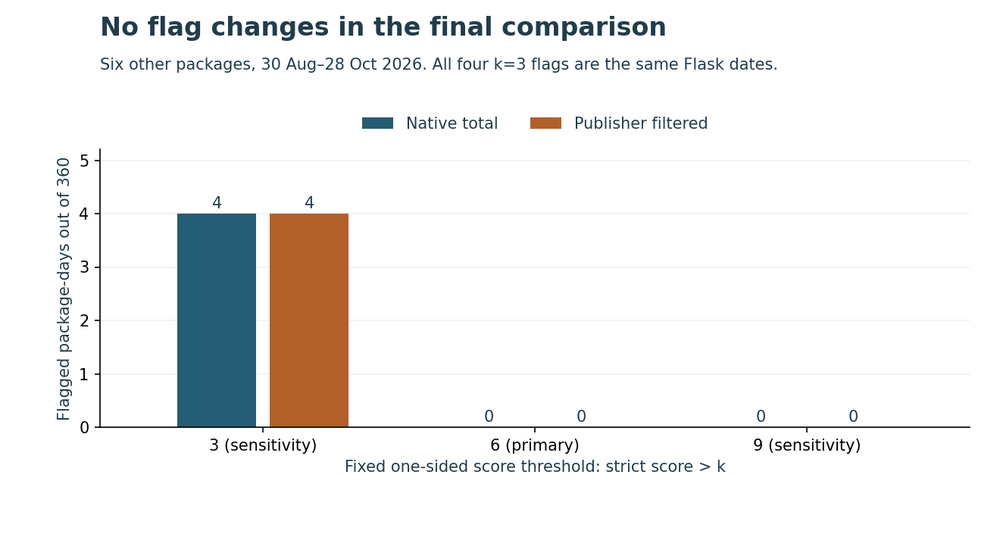

# A traffic filter changed counts without changing these alerts

A package owner investigating a download spike needs to know which traffic is counted. This study compares a fixed rule on paired PyPIStats native totals and publisher-filtered counts.

**Finding:** filtering changes **zero flags across 360 final package-days** at every predeclared threshold. The primary threshold, score > 6, emits no flags. At score > 3, both views flag the same four Flask dates. This sample provides **no observed alert reduction**.

Keep the counter definition with the alert and inspect both today's count and the historical baseline before allocating attention. The publisher filter also excludes unknown installers in the inspected SQL and leaves CI/CD traffic. It cannot turn downloads into actual users or adoption. There are no trusted anomaly labels, measured analyst time savings or production results.

Read the [six-page independent study](paper/manuscript.pdf), inspect [all final thresholds and package results](results/final/summary.json), or run the [offline implementation exercise](IMPLEMENTATION_EXERCISE.md).

~~~sh
python -m pip install -r requirements.txt
python src/review_cli.py examples/removed-current-spike.json
python src/review_cli.py examples/revealed-filtered-spike.json
python src/replay.py --output ../fresh-replay
~~~

The examples are authored. One spike clears after filtering; another appears because its historical baseline also changes. A short history remains UNKNOWN. The CLI makes no network request or outgoing alert.

## What was checked

- Twelve fixed packages, assigned before acquisition to six development and six final packages by SHA256 ordering. All have 150 paired dates from 1 June through 28 October 2026. No missing date is zero-filled.
- Twelve exact private aggregate entities, 346,249 decoded bytes, 4,920 source cells and 1,800 public paired rows. Independent SQLite JSON1 reconstruction passes 8,558 source conditions. Source captures contain 205 dates each; out-of-window values stay in the qualification ledger and are not scored.
- Native and filtered counts are nested: removed = native minus filtered. Adding the two double-counts traffic. The 28-day log-MAD score, 0.1 floor and thresholds 3/6/9 are authored illustrative choices, with no fitting, tuning or optimum claim.
- Development: 372 scorable origins and 168 warm-up history exclusions, no flags at any setting, 12,991 independent SQLite/Decimal conditions. [Twenty-nine dependencies](data/dependency_freeze.json) were committed before final score extraction. Source counters were already available; collection was not blinded.
- Final: 360 scorable origins, no unknown origin, 12,643 independent conditions, exact flag agreement at all settings. Both the pooled and equal-package flag-change fractions are zero. Filtering only today's count also leaves the same flags.
- Twenty-one boundary fixture methods; three inspected figures with 378 source values, 864 actual SVG coordinates and nine file hashes; 61 source-bound manuscript displays, 272 paper conditions and all six rendered pages.

## Reproduce and interpret

Use a full-history clone and a fresh output directory outside the checkout. Replay recomputes both phases, independently checks results, verifies frozen bytes, exercises all three authored examples and preserves the source JSON files. It uses saved aggregates and makes no source requests. Fresh runtime receipts do not replace original measurements. Exact replay, CI and release evidence belong to the selected revision; see the [pull request](https://github.com/S3R3Bii/download-spike-context/pull/2) and [Actions](https://github.com/S3R3Bii/download-spike-context/actions).

[Protocol](PROTOCOL.md), [data attribution and meaning](DATA_RIGHTS.md), [source revision clarification](SOURCE_REVISION_CLARIFICATION.md), [environment](ENVIRONMENT.md) and [review receipt](REVIEW_RECEIPT.json) provide the underlying evidence. The frozen historical documents mislabel a publisher commit as a tree; the explicit clarification verifies the actual tree and unchanged inspected blob identities. This wording correction changed no analytical dependency or outcome.

The cohort is an authored selection of familiar Python packages, observed in one current source vintage. Package-days overlap and share infrastructure. The unchanged result does not prove filtering can never change a flag. The exercise demonstrates why both directions must be checked, while the measured sample establishes neither false-positive reduction nor adoption, causality, incidents, deployment benefit or scientific novelty. A broader prospective cohort needs real review decisions and outcome labels before choosing an operational policy.

Source aggregate data: PyPI / Python Software Foundation and PSF-hosted PyPIStats, attributed under [CC BY 4.0](https://creativecommons.org/licenses/by/4.0/); projections and calculations are modifications. MIT applies to our code. No raw logs, IP/client records, package files or credentials are included. This independent study is not peer reviewed. Formal-publication projects, including Azure optimization, remain private.
